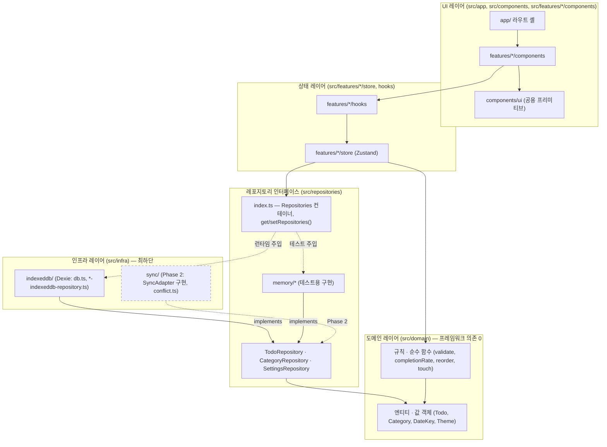

<!-- 읽기 조건: 레이어 경계를 넘는 변경(domain/repositories/infra 수정, 새 feature 디렉토리 생성, 스키마 변경)을 하기 전. 단일 컴포넌트 수정에는 불필요. -->

# Tasky 아키텍처 맵

코드가 아직 없으므로 이 문서는 **앞으로 만들 구조**의 단일 소스다. 구현이 이 문서와 달라지면 ADR + 이 문서 갱신이 한 PR에 있어야 한다.
디렉토리별 세부 규칙은 각 노드의 `AGENTS.md`에만 있다(여기에 중복하지 않는다).

## 1. 레이어와 의존 방향



**의존 규칙 — `eslint.config.mjs`가 강제한다.** 레이어 간 import는 `import/no-restricted-paths`(해석된 실제 경로 기준이라 `@/` 별칭·상대 경로·배럴 `index.ts` 어느 쪽으로도 우회 불가), 외부 패키지는 `no-restricted-imports`. 규칙이 실제로 위반을 잡는지는 `scripts/check-arch.sh`가 위반 픽스처로 검증하고, 아키텍처 규칙의 `eslint-disable`은 `scripts/check-eslint-disable.sh`가 거부한다.
**스캐폴딩 전(`package.json` 없음)에는 린트가 존재하지 않는다** — 그때까지 이 표는 문서일 뿐이므로 `src/` 코드 티켓은 스캐폴딩 PR 머지 후에만 발행한다.

| 레이어 | import 허용 | import 금지 |
|--------|------------|------------|
| `src/app` | `features`(index), `components`, `lib`, `styles` | `domain` 직접(훅 경유), `repositories`, `infra`, `test`. 예외: `app/providers.tsx`는 `repositories`·`infra` 허용 |
| `src/components` | `lib`, `styles` | `app`, `features`, `domain`, `repositories`, `infra`, `test`, `dexie`, `zustand` (무상태 프리미티브) |
| `src/features/<f>` | `domain`, `repositories`(인터페이스·컨테이너), `components`, `lib`, `styles`, 다른 feature의 `index.ts`(`@/features/<other>`) | `app`, `infra`, `test`, 다른 feature의 내부 경로, `dexie` |
| `src/domain` | `lib`(순수 유틸만) | 그 외 `src/*` 전부, `react`, `next`, `dexie`, `zustand`, 브라우저 전역, `Date`·`crypto`·`Math.random` 직접 호출(`deps`로 주입) |
| `src/repositories` | `domain`, `lib` | 그 외 `src/*` 전부, `react`, `next`, `dexie`, `zustand` |
| `src/infra` | `domain`, `repositories`(인터페이스), `lib`, `dexie` | `app`, `components`, `features`, `test`, `react`, `next`, `zustand` |
| `src/lib` | 외부 순수 패키지 | `src/*` 전부, 프레임워크·저장소 패키지 |
| `src/test`, `*.test.*` | 전부(계약 테스트가 구현을 직접 돌린다) | — (역방향: 테스트가 아닌 파일은 `src/test`를 import 금지) |

원칙: **UI → 상태 → 도메인 → 인터페이스 ← 인프라**. 인프라는 인터페이스를 구현할 뿐, 누구도 인프라를 import하지 않는다. 예외는 조립 지점 두 파일(§6)뿐. 경로 표기는 "같은 디렉토리 안은 상대 경로, 경계를 넘을 때만 `@/`"(code-style.md §7).

## 2. 디렉토리 트리 (각 노드 → 그 디렉토리의 `AGENTS.md`)

```
Tasky/
├── CLAUDE.md · AGENTS.md · README.md
├── .github/            → .github/AGENTS.md
├── .githooks/          → .githooks/AGENTS.md
├── .worktrees/         → .worktrees/AGENTS.md         (gitignore, 로컬 보드/티켓)
├── scripts/            → scripts/AGENTS.md
├── docs/               → docs/AGENTS.md
│   ├── conventions/    → docs/conventions/AGENTS.md
│   ├── research/       → docs/research/AGENTS.md
│   ├── specs/          → docs/specs/AGENTS.md
│   └── decisions/      → docs/decisions/AGENTS.md
├── public/             (아이콘, manifest — AGENTS.md 불필요: 정적 자산만)
├── tests/e2e/          → tests/AGENTS.md              (스캐폴딩 후)
└── src/                → src/AGENTS.md                (스캐폴딩 후, 아래 전부 동일)
    ├── app/            → src/app/AGENTS.md            라우트·레이아웃·providers·PWA 메타
    ├── components/     → src/components/AGENTS.md     ui/ 프리미티브(Button, Checkbox, Popover…)
    ├── features/       → src/features/AGENTS.md
    │   ├── todo/         투두 목록·아이템·입력, todo-store
    │   ├── category/     카테고리 관리·색상 선택, category-store
    │   ├── date-strip/   날짜 스트립·선택 날짜, date-store
    │   ├── stats/        달성률 표시(도메인 계산 결과 렌더)
    │   └── theme/        테마 토글·강조색, theme-store
    ├── domain/         → src/domain/AGENTS.md
    │   ├── todo/  category/  date/  theme/  meta.ts(Meta, touch)  errors.ts
    ├── repositories/   → src/repositories/AGENTS.md
    │   ├── todo-repository.ts  category-repository.ts  settings-repository.ts
    │   ├── memory/           in-memory 구현(테스트)
    │   └── index.ts          컨테이너
    ├── infra/          → src/infra/AGENTS.md
    │   ├── indexeddb/        db.ts(Dexie 스키마·버전), *-indexeddb-repository.ts
    │   └── sync/             (Phase 2 — 지금은 만들지 않음)
    ├── lib/            → src/lib/AGENTS.md            cn.ts, date.ts(nowIso), id.ts(newId)
    ├── styles/         → src/styles/AGENTS.md         tokens.css, globals.css
    └── test/           → src/test/AGENTS.md           setup.ts, fixtures/
```
링크가 있는 표 형태는 [DIRECTORY_MAP.md](./DIRECTORY_MAP.md).

## 3. 레이어별 책임

| 레이어 | 책임 | 하지 않는 것 |
|--------|------|------------|
| UI | 렌더, 이벤트 → 훅 호출, 접근성, 토큰 기반 스타일 | 계산, 저장, 검증 |
| 상태 | 화면 상태 보관, 레포지토리 호출 오케스트레이션, 낙관적 갱신·롤백, 에러 → 사용자 문구 | 비즈니스 규칙 판단(도메인에 위임) |
| 도메인 | 엔티티 정의, 검증, 계산(달성률·정렬), 불변 업데이트 함수(`touch` 포함) | I/O, 프레임워크, 시간/ID 생성(주입받음) |
| 인터페이스 | 저장소 계약(`Promise` 기반, 도메인 타입만), 컨테이너 | 구현 세부, 시각·`rev` 생성 |
| 인프라 | Dexie 스키마·버전·마이그레이션, 직렬화, 인터페이스 구현 | 도메인 규칙, UI 상태 |

## 4. 데이터 모델 (MVP)

```ts
type DateKey  = `${number}-${number}-${number}`;                                            // 'YYYY-MM-DD'
type Meta     = { id: string; createdAt: string; updatedAt: string; rev: number; deletedAt?: string }; // 공통 필드 — 의미·규칙은 ADR-0005
type Todo     = Meta & { categoryId: string; date: DateKey; title: string; done: boolean; order: number };
type Category = Meta & { name: string; color: string; emoji?: string; order: number };
type Settings = Meta & { id: 'default'; theme: 'light' | 'dark' | 'system'; accentColor: string };
```
- `Meta`는 세 엔티티 모두 **예외 없이** 갖는다. `id`는 UUID v4(`lib/id.ts#newId()`), 시각은 ISO 8601 UTC(`toISOString()` 형식), `rev`는 쓰기마다 +1. 모든 변경은 도메인 `touch(entity, now)`를 거친다. 근거와 "지금 안 하면 드는 비용": ADR-0005.
- `Settings`는 단일 행(고정 id `'default'`)이다. 별도 key-value 테이블은 타입 안정성을 잃고, 다른 저장소(localStorage)는 계약 테스트·동기화 경로에서 빠지므로 기각. `SettingsRepository`에 `remove`가 없어 `deletedAt`은 설정되지 않는다(타입은 공통 유지 — 계약 테스트 단순화).
- IndexedDB 인덱스: `todos: id, date, categoryId, [date+categoryId], updatedAt`, `categories: id, order`, `settings: id`. 인덱스에 없는 필드(`rev`, `deletedAt`)는 Dexie 버전업 없이 추가·변경 가능.

## 5. 확장 지점 (지금 만들지 않되, 막지 않는다)

| 확장 | 예약 위치 | MVP에서 지킬 것 |
|------|---------|---------------|
| 클라우드 동기화 | `src/infra/sync/`(어댑터 + `conflict.ts` 충돌 정책), `repositories/sync-adapter.ts`(Phase 2에 추가) | `Meta` 유지·`touch` 경유·소프트 삭제(ADR-0005), 레포지토리 외부에서 Dexie 참조 금지, ID 클라이언트 생성 |
| SNS(친구·피드·반응) | `src/features/social/`, `src/domain/social/` | `Todo`에 `visibility` 같은 필드를 **미리 넣지 않는다**(YAGNI). 스키마 버전업으로 대응 |
| 루틴/반복 투두 | `src/domain/todo/recurrence.ts` | `Todo.date`는 인스턴스 날짜로 유지(템플릿과 분리) |
| 다중 프로필/계정 | `Settings.id`를 프로필 id로(지금은 `'default'`) + `todos`/`categories`에 프로필 키 | 단일 프로필 가정, DB 이름 `tasky` 고정. 인덱스가 전부 `[date+…]` 접두이므로 도입 시 전 인덱스 재작성 — 착수 전 ADR 필수 |
| 서버 컴포넌트 활용 | `src/app` | 로컬 우선이므로 데이터는 전부 클라이언트. 서버 컴포넌트는 셸/메타데이터만 |

## 6. 조립 지점

`src/app/providers.tsx`(client): 앱 시작 시 `setRepositories(createIndexedDbRepositories())` → 각 feature store가 `getRepositories()`로 사용. 테스트는 `src/test/setup.ts`에서 `setRepositories(createMemoryRepositories())`. 이 두 파일과 테스트 파일(`*.test.*`) 외에 `infra`를 import하면 `pnpm lint`가 실패한다(§1).

## 7. 관련 ADR

- [ADR-0001](./decisions/ADR-0001-nextjs-app-router.md) Next.js App Router + PWA
- [ADR-0002](./decisions/ADR-0002-local-first-indexeddb-repository.md) 로컬 우선 + IndexedDB(Dexie) + repository 패턴
- [ADR-0003](./decisions/ADR-0003-state-and-styling.md) Zustand + Tailwind v4 + CSS 변수 토큰
- [ADR-0004](./decisions/ADR-0004-agent-collaboration-rules.md) 멀티 에이전트 협업 규칙
- [ADR-0005](./decisions/ADR-0005-entity-meta-and-sync-readiness.md) 엔티티 공통 필드와 동기화 대비 규칙
